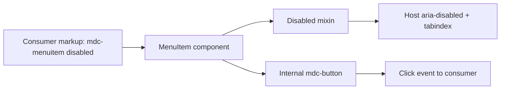

BLOCKING REQUIREMENT: This file has 370 lines. IT IS CRITICAL THAT YOU READ THE ENTIRE FILE BEFORE APPLYING THIS SKILL.

# Expert Review

Perform a comprehensive review of the provided PR. This skill is for complex reviews where correctness alone is not
enough. Evaluate API and architectural fit, runtime evidence, dependency boundaries, test quality, consumer impact, and
decisions that require human judgment.

Momentum Design is a design system: every change to a published package is a contract change for downstream
applications. Review with the consumer in mind, not just the diff.

## Relationship To Existing Review Guidance

Before starting, read and apply the repository's normal review guidance:

- [CONTRIBUTING.md](../../../CONTRIBUTING.md#pr-reviews) - review expectations, conventional comments, commit and PR
  title rules
- [AGENTS.md](../../../AGENTS.md) - repository-wide guidance
- The nearest package `AGENTS.md` for every changed package, for example
  [packages/components/AGENTS.md](../../../packages/components/AGENTS.md)
- [packages/components/conventions/README.md](../../../packages/components/conventions/README.md) - read the index
  completely, then read only the convention documents whose `Applies when` column matches the diff. Cite the
  convention in the finding.

Do not duplicate those files here. This skill adds an expert-review layer: sub-agent orchestration, model-family
diversity, validation worktrees, architecture diagrams, mandatory review lenses, and completion gates. Inline GitHub
comments should follow [conventional comments](https://conventionalcomments.org/) labels: `issue:`, `suggestion:`,
`nitpick:`, `question:`, `thought:`, or `praise:`.

## AI-Assisted Review Context

If the PR or review process uses AI, label that context as **AI-Assisted** and record the tool/model family when known.
Do not treat AI-authored code, bot comments, or generated test evidence as correct until it has been checked against
repository conventions and reproducible evidence.

## Sub-Agent Orchestration

Use sub-agents for deep review lanes. Assign each lane a bounded question and require evidence, not general impressions.

Run model-diverse review when available:

1. Use one high-capability sub-agent from the same model family that authored or last materially modified the PR, if
   that is known.
2. Use at least one high-capability sub-agent from a different model family to catch same-family blind spots.
3. If model provenance or model-family options are unavailable, use the highest-capability sub-agents available and
   record the limitation in the report.

Recommended lanes:

- **Architecture lane** - component/mixin/controller boundaries, file placement against the folder-structure
  convention, public vs. private API surface, reuse of existing mixins and utilities, and whether the design is
  simpler than the implementation.
- **Validation lane** - local reproduction in Storybook and Playwright, test evidence, temporary probes, negative
  paths, and whether claimed behavior survives runtime validation.
- **API/dependency lane** - changes to attributes, properties, events, slots, CSS parts, CSS custom properties, and
  exports; custom-elements manifest and generated React wrapper impact; token and icon asset contracts; package
  dependency changes; browser/platform boundaries.
- **Consumer-impact lane** - accessibility, RTL and text expansion, theming, visual states, framework consumption
  (plain HTML, React, SSR), performance, and security-sensitive rendering surfaces.

The lead reviewer must synthesize disagreements instead of pasting sub-agent outputs together. For each sub-agent,
record model family if known, reviewed scope, important files inspected, evidence used, and unresolved questions.

## Required Output

Output = `.md` containing:

1. **Review Lens Checklist** with every required lens checked and justified.
2. **Brief Summary** of what changed and which consumer-facing contract or system surface is actually under review.
3. **Architecture Diagrams** in Mermaid, scoped to changed and affected components/modules.
4. **Findings Table** with problems and question points, including file/line references and evidence.
5. **Validation Evidence** with exact commands, SHAs, test results, and probe/source labels.
6. **Human Decision Register** for decisions that could reasonably go either way and need a domain owner, design (UX or
   visual), accessibility, CODEOWNER, security, or product reviewer.
7. **Completion Gate** proving every required lens was completed.

Do not include remediation recommendations unless the user asks for them. The default output is review evidence and
questions, not a fix plan.

## GitHub Posting Guardrails

Expert-review output is advisory. Do not approve, reject, request changes, or otherwise submit a formal GitHub review
decision from this skill; [CONTRIBUTING.md](../../../CONTRIBUTING.md#reviewing-a-pr) reserves "Approve" and "Request
changes" for human reviewers. Prefer a Markdown report, top-level comment, or inline comments that leave the final
decision to humans. If the user asks for a formal GitHub review action, stop and ask them to switch out of this
expert-review workflow or confirm a separate human-directed GitHub review action.

Do not resolve review threads or dismiss anyone's review. Comments from a reviewer are resolved by that reviewer.

Every GitHub comment generated from this skill must clearly label itself as AI-generated. Prefix top-level and inline
comments with:

```markdown
> [!WARNING]
> AI-Generated review comment. Human reviewer judgment is required before treating this as a PR decision.
```

When a comment includes a human reviewer's stated preference, threshold, or product judgment, label that separately
from probe/static evidence. Do not present a human-provided decision as independently discovered evidence.

## Summary Examples

A useful summary identifies the changed contract or system boundary, not just file names:

- "Adds a `variant` attribute to `mdc-badge` and maps it to new token-backed styles. The reviewed surface is the public
  attribute type, the generated React wrapper, and every existing consumer that renders the default variant."
- "Moves focus handling from `mdc-menupopover` into a shared mixin. The reviewed surface is keyboard and focus behavior
  for every component that now consumes the mixin."
- "Updates a dependency and adapts the build config. The reviewed surface is the emitted `dist` output, the
  custom-elements manifest, and the packages that import from it."

Avoid vague summaries such as "This PR updates styles and fixes a bug." Name the behavior, boundary, and affected
consumers.

## Architecture Diagrams

Use Mermaid `flowchart` diagrams unless the target system cannot render Mermaid. Do not use ASCII diagrams by default.

Diagram requirements:

- Show component/module-level boundaries, not every function call.
- Include only nodes affected by the PR or needed to explain blast radius.
- Separate the boundaries that apply: consumer markup, component class, mixins/controllers, internal child components,
  styles/tokens, generated artifacts (manifest, React wrappers, `dist`), and browser/platform APIs.
- Label important edges so findings can reference them.
- Ground system-level questions in the diagram by citing node or edge labels in findings.

Example:



Finding reference example: "The new guard sits at `C` but the click still reaches the consumer through `E -> F`; trace
that downstream path before claiming the disabled state is enforced."

## Required Review Lenses

The review is incomplete until every lens below has either at least one finding or an explicit
`Nothing found - <one sentence of evidence>` / `N/A - <why it does not apply>` note. Do not stop after the first useful
finding.

- [ ] **Validation Lens** - Does the implementation satisfy the PR description, design spec, acceptance
      criteria, and claimed test evidence? Check for promised requirements that were not implemented, and that the PR
      description (including the Breaking Change section) matches the diff.
- [ ] **Architecture Lens** - Does responsibility live at the right layer? Check mixin vs. component vs. controller
      placement, reuse of existing utilities in `packages/components/src/utils/`, file placement against
      [component-code-structure](../../../packages/components/conventions/component-code-structure.md), state that can be
      derived instead of stored, and whether an existing component should be composed instead of re-implemented.
- [ ] **Bug-Shaped Lens** - Look for likely runtime failures: Lit lifecycle misuse (`willUpdate`/`updated` ordering,
      property vs. attribute reflection), missing cleanup in `disconnectedCallback()`, stale state, race conditions,
      event listeners that leak, incorrect fallbacks, and behavior that differs between programmatic and user-initiated
      changes.
- [ ] **Testing Lens** - Do Playwright tests exercise the real public API (attributes, properties, events, keyboard)
      rather than internals, CSS classes, or DOM structure? Are accessibility and interaction cases covered, not just
      screenshots? Are visual snapshots added or updated intentionally and only via Docker? Check whether tests encode
      broken behavior as expected output. See [packages/components/TESTING.md](../../../packages/components/TESTING.md).
- [ ] **Dependency Lens** - Are dependency upgrades, new packages, build/tooling changes, and cross-workspace imports
      reviewed separately from local code? Check [.syncpackrc](../../../.syncpackrc) policy, lockfile intent, and the
      [no relative workspace imports](../../../packages/components/conventions/no-relative-imports-workspace.md)
      convention. Dependency changes require a more thorough manual test.
- [ ] **Security Lens** - Check consumer-controlled strings reaching `unsafeHTML`/`innerHTML`, URL and `href` handling,
      event payloads, slotted content trust, and dependency risk. Say `Nothing found` if no security-sensitive surface
      changed.
- [ ] **Accessibility Lens** - Check roles, ARIA ownership (host vs. delegated, per
      [component-aria-delegation](../../../packages/components/conventions/component-aria-delegation.md)), accessible
      names, keyboard interaction, focus management and restoration, live regions, `forced-colors` and reduced-motion
      handling, and whether visible and announced text stay consistent. Verify with the keyboard and, where
      possible, a screen reader, not only automated checks. See
      [knowledge-base/accessibility.md](../../../knowledge-base/accessibility.md).
- [ ] **Internationalization / Responsive Lens** - Check RTL behavior (logical properties, icon mirroring), text
      expansion and truncation, text ownership per
      [component-text-ownership](../../../packages/components/conventions/component-text-ownership.md), and behavior at
      narrow widths. See [knowledge-base/internationalization.md](../../../knowledge-base/internationalization.md) and
      [knowledge-base/responsive-design.md](../../../knowledge-base/responsive-design.md).
- [ ] **Styling / Theming Lens** - Are only design tokens (`--mds-*`) used rather than hard-coded values? Does the
      change follow [component-styling](../../../packages/components/conventions/component-styling.md) and
      [data-attributes-on-host](../../../packages/components/conventions/data-attributes-on-host.md)? Does it work in
      every supported theme and not only the default? Is any new CSS syntax, property, selector, or runtime API
      supported by the browsers the library targets (Chrome, Edge, Firefox, Safari/WebKit per
      [TESTING.md](../../../packages/components/TESTING.md))? Verify against compatibility data rather than from memory.
- [ ] **Public API / Compatibility Lens** - Does the change alter attributes, properties, events, slots, CSS parts, CSS
      custom properties, exports, or tag names? Is it backward compatible, and if not, is it marked as breaking in the
      PR title and description with a migration path? Check naming against
      [component-naming-guidelines](../../../packages/components/conventions/component-naming-guidelines.md), type
      handling against [constants-and-enums](../../../packages/components/conventions/constants-and-enums.md), TSDoc
      against [component-tsdoc](../../../packages/components/conventions/component-tsdoc.md), and the regenerated
      manifest and React wrapper output.
- [ ] **Performance / Scale Lens** - What happens with many instances on one page, frequent re-renders, large slotted
      content, long lists, or repeated events? Check for work in `render()` that belongs in `willUpdate()`, unbounded
      queues, and bundle-size impact of new imports.
- [ ] **Blast-Radius Lens** - Which existing consumers now observe the new behavior? Include components that compose or
      extend the changed one, shared mixins and utilities, token consumers, generated React wrappers, Code Connect
      templates, Storybook stories, docs, and knowledge-base topics that describe the component.
- [ ] **Documentation Lens** - Are Storybook stories (with an `Example` story and correct title group), TSDoc, the
      knowledge-base topic, and Code Connect templates updated to match the change? Does the PR title follow the
      enforced conventional-commit pattern in [CONTRIBUTING.md](../../../CONTRIBUTING.md#pull-request-title)?
- [ ] **Human-Decision Lens** - Identify decisions that may be valid either way but need a domain owner, designer,
      accessibility specialist, CODEOWNER, security, or product reviewer to confirm.

## Completion Gate

Before finalizing the review:

1. Re-read the Required Review Lenses.
2. Every checkbox must be checked.
3. Every lens must have one of:
   - one or more findings,
   - `Nothing found - <one sentence of evidence>`, or
   - `N/A - <why it does not apply>`.
4. If a finding came from one lens but affects another, cross-reference it instead of leaving that second lens blank.
5. The final review must separate:
   - blocking bugs,
   - architectural and API concerns,
   - test-evidence gaps,
   - human-review questions.

## Validation Worktree And Evidence

[CONTRIBUTING.md](../../../CONTRIBUTING.md#reviewing-a-pr) requires every PR to be checked out locally, run, and tested
manually. When a finding depends on runtime behavior, test behavior, or a scenario that may or may not be valid, create
a disposable worktree from the reviewed PR head before concluding:

```bash
git fetch origin pull/<PR_NUMBER>/head:review/pr-<PR_NUMBER>
git worktree add <TMP_DIR>/momentum-design-pr<PR_NUMBER> review/pr-<PR_NUMBER>
git -C <TMP_DIR>/momentum-design-pr<PR_NUMBER> rev-parse HEAD
```

A fresh worktree has no installed dependencies or generated output. Run `yarn install` in the worktree and build what
the validation needs (for example `yarn components build:components`) before running anything. Record the commands.

Before using any local server, browser session, or probe as PR evidence, prove it is running the reviewed SHA:

```bash
git -C <TMP_DIR>/momentum-design-pr<PR_NUMBER> rev-parse HEAD
git -C <TMP_DIR>/momentum-design-pr<PR_NUMBER> status --short --branch
curl -sI http://localhost:<PORT>
```

If a Storybook server, browser session, or existing worktree is already running, do not assume it is the reviewed PR.
Verify its cwd, branch, SHA, and port before relying on it. If the running server differs from the reviewed SHA, either
start a separate server from the review worktree on a different port or label the result as non-authoritative
comparison evidence.

For each focused validation, record:

- exact reviewed SHA,
- every targeted command run,
- pass/fail result,
- warnings/errors that matter even if the command passed,
- whether evidence came from static review, an existing test, a modified local test, a temporary probe, or the real
  Storybook/consumer path.

If you modify tests locally to prove the PR is wrong, keep those changes out of the feature branch. Summarize the
smallest diff in the review or publish a separate review-evidence branch/artifact. Do not claim validation without
enough commands and evidence for the author to reproduce it.

## Local Storybook, E2E, And Browser Validation

For component, styling, accessibility, and interaction findings, use the disposable worktree to run the library locally
and validate the closest realistic path available. Commands run from the repo root; see
[packages/components/AGENTS.md](../../../packages/components/AGENTS.md#build-and-dev-commands) for the full list.

1. Run static analysis scoped to the change and record results: `yarn components analyze:lint`,
   `yarn components analyze:style`, and `yarn components analyze:syntax`. For repo-level changes also run
   `yarn analyze:root`.
2. Start Storybook from the review worktree with `yarn components dev` (default port 6006) and record the exact
   command, port, and reviewed SHA. Use the `navigating-storybook` skill for Chrome DevTools MCP navigation.
3. Run the relevant Playwright test locally when one exists, scoped to the component under review, for example
   `yarn components test:e2e:chrome <path-to-e2e-test>`. Use `yarn components test:e2e:serve` in a separate terminal
   to serve the e2e build on port 4000. Local runs skip visual snapshots.
4. Check every supported engine that the change could affect (Chrome, Firefox, WebKit, Edge) with the
   `test:e2e:firefox`, `test:e2e:webkit`, and `test:e2e:edge` scripts. Missing local browsers are not a finding;
   CI has them all.
5. When the existing e2e test is too broad or missing, temporarily add a local-only focused test or probe for the
   specific scenario.
6. Add negative-path checks based on review leads: disabled and read-only states, missing or invalid attributes,
   empty and very long slotted content, RTL, narrow viewport, keyboard-only use, `prefers-reduced-motion`, forced
   colors, and each theme.
7. Capture useful diagnostics: browser console errors and warnings (including Lit dev-mode warnings), failed requests,
   screenshots, traces, and the accessibility tree.
8. Visual snapshot changes must be reviewed image by image and can only be regenerated with the Docker or Podman
   scripts. Do not accept a snapshot update as evidence that behavior is correct; it only proves the output changed.
9. Clearly label whether evidence came from Storybook, the e2e build, a plain-HTML consumer page, a React consumer,
   a unit/e2e test, or static review only.

A review finding should distinguish proof levels. "The component renders correctly in the default Storybook story" is
weaker than "the keyboard path, RTL, and each theme were verified on the reviewed SHA, in Chrome and Firefox".

When a headless probe and a live headed DevTools run disagree:

1. Pause before posting or escalating the finding.
2. Re-verify that both runs used the same PR SHA, worktree, port, browser, and URL.
3. Compare the console and network logs for the exact resources, status codes, and event timing.
4. Treat the headed real-browser path as preferred evidence unless there is a documented reason it is less
   representative.
5. Record the disagreement as a review-process note so humans can learn from the probe failure.

## Thinking Disciplines

Apply these passes while reviewing:

- **Challenge the code's framing** - State the consumer operation first, then count the technical steps. If one
  consumer intent requires many attributes, events, slots, or internal state fields, question the API before
  verifying each piece.
- **Question placement, not just correctness** - Correct code in the wrong layer is a design problem. Behavior shared by
  several components belongs in a mixin or utility; behavior specific to one component should not leak into one.
- **Public by default is a liability** - Every new public attribute, property, event, part, slot, or CSS custom property
  is a long-term commitment. Ask whether it must be public and whether a private member or an existing API
  covers the need.
- **Trace guards both ways** - For relaxed guards, trace downstream consumers to ensure no later guard re-blocks the
  enabled behavior. For new guards, trace upstream to prove the guarded state can occur.
- **Name dependency compensation** - If code exists only because a browser, library, or framework behaves awkwardly,
  identify the workaround explicitly, with the root cause and the condition for removing it.
- **Delete pass** - For every wrapper, helper, parameter, state field, and defensive check, ask what would break if it
  disappeared. Flag anything that only adds indirection or duplicate state.
- **Switch audiences** - Review from the end user's perspective (including assistive technology users), the consuming
  developer's perspective (plain HTML and React), and the design-system-at-scale perspective.
- **Source of truth** - Check that information is not duplicated across docs, stories, TSDoc, and knowledge base. Each
  fact should have one canonical location with links elsewhere.

## Ambiguity Handling

If information is missing, do something concrete:

1. Add a row to the Findings Table or Human Decision Register.
2. Name the exact missing evidence or owner decision.
3. State why the review cannot safely infer the answer.
4. Identify the smallest source that would resolve it, such as a CODEOWNER answer, a Figma spec, a design or
   accessibility decision, a web-standard reference, a browser test, or a local validation result.

Never write "flag this up" or leave ambiguity as a vague note.

## Examples

### Findings Table Example

| Severity | Lens           | Reference                                                              | Evidence                                                                                           | Finding                                                                                                                  |
| -------- | -------------- | ---------------------------------------------------------------------- | -------------------------------------------------------------------------------------------------- | ------------------------------------------------------------------------------------------------------------------------ |
| issue    | Blast-Radius   | `packages/components/src/components/foo/foo.component.ts:42`, `C -> E` | Static trace shows the disabled guard is on the host, but the internal button still emits `click`. | The new guard does not stop the event reaching consumers; trace the internal child's event path before claiming support. |
| question | Human-Decision | PR description, Diagram `B -> D`                                       | The design spec does not say what the component shows when the `label` slot is empty.              | Design owner should confirm whether the empty state hides the label region or renders a placeholder.                     |
| issue    | Public API     | `foo.types.ts:12`                                                      | The PR title is `feat(foo)` but a public attribute value was removed.                              | Removal is a breaking change; the PR title and Breaking Change section do not reflect it.                                |

### Human Decision Register Example

| Decision                                              | Owner                        | Why It Needs Human Judgment                                             | Evidence Needed                                   |
| ----------------------------------------------------- | ---------------------------- | ----------------------------------------------------------------------- | ------------------------------------------------- |
| Should the new `size` attribute accept an `xl` value? | Design / component CODEOWNER | Both outcomes are plausible, and code alone cannot establish the scale. | Figma spec or an existing sizing decision record. |

### Validation Evidence Example

```markdown
Reviewed SHA: abc1234
Worktree: <TMP_DIR>/momentum-design-pr1234
Command: yarn components test:e2e:chrome packages/components/src/components/foo/foo.e2e-test.ts
Result: passed, but the console showed a Lit dev-mode "change-in-update" warning
Evidence source: modified local test probe, not committed
Conclusion: the existing test asserts the default state only and never exercises the `disabled` keyboard path
```
